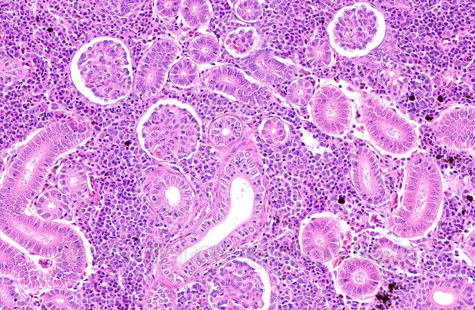
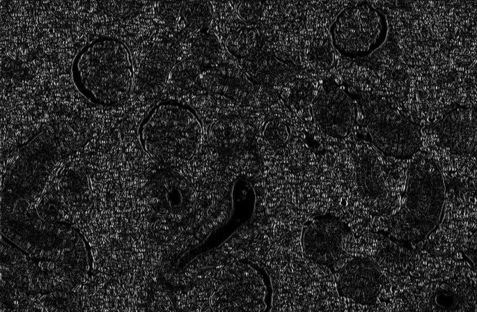
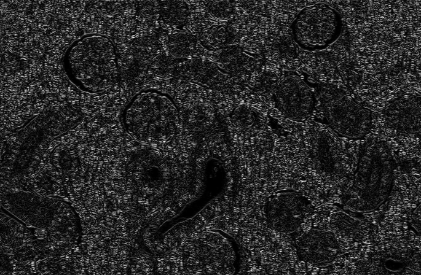
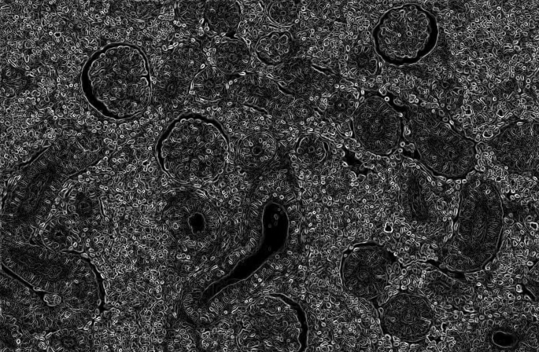
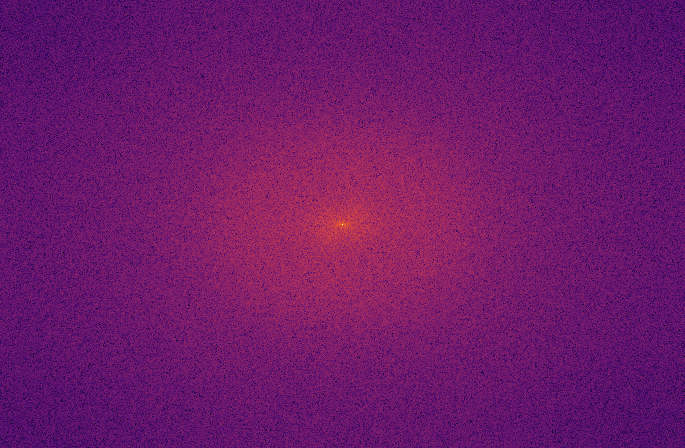
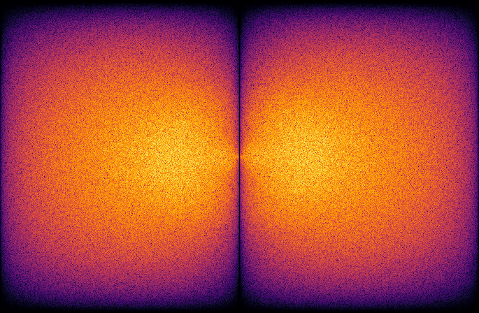
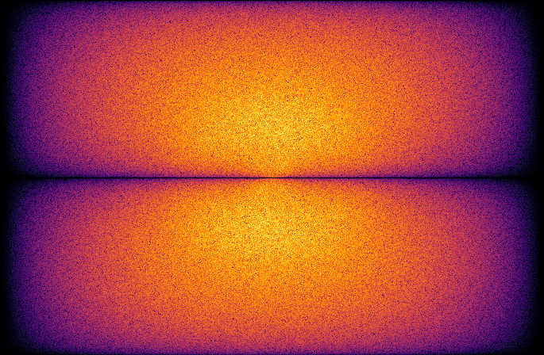
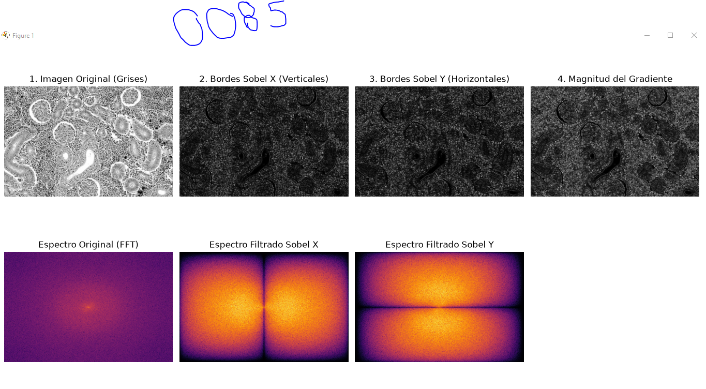

## Ricardo Lopez NC 0085
## problema 32-tejido renal

## imagen original

## bordes x

## bordes y

## magnitud gradiante

## espectro original

## espectro filtrado sobel x

## espectro filtrado y

## imagenes juntas

